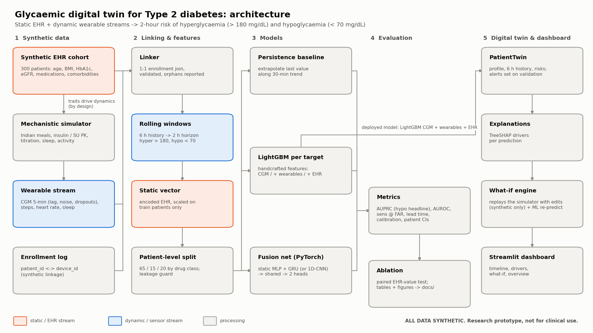

# Glycaemic Digital Twin: predicting post-meal spikes and dangerous lows in Type 2 diabetes

[](https://github.com/AkhileshNalla11/glycaemic-digital-twin/actions/workflows/tests.yml)

> **Trained on synthetic data only. Not a medical device. Not for clinical use.** A proof of concept for
> the Happiest Health *Digital Twin Challenge 2026*. No real patient data is used for training, and the
> link between the EHR and wearable streams is synthetic by design. Two public, de-identified real datasets
> (CGMacros, ShanghaiT2DM) are used only to check the models; you download them yourself, and they are
> never committed to this repository.



## Team
| | |
|---|---|
| Team name | _TODO_ |
| Members | _TODO: names, roles_ |
| Institution | _TODO_ |
| Contact | _TODO_ |

## Submission materials

| | |
|---|---|
| Presentation | [docs/presentation.pdf](docs/presentation.pdf) · editable [docs/presentation.pptx](docs/presentation.pptx) (20 slides, speaker notes included) |
| Architecture diagram | [docs/architecture.pdf](docs/architecture.pdf) · [PNG](docs/architecture.png) · [Mermaid source](docs/architecture.mmd) |
| Video (at least 20 min) | _TODO: unlisted YouTube link_ · script: [docs/video_script.md](docs/video_script.md) |
| Live dashboard | _TODO: Streamlit Community Cloud link_ |
| Model card | [docs/model_card.md](docs/model_card.md) |
| Licence | MIT ([LICENSE](LICENSE)) |

## Problem statement and healthcare use case

India has one of the world's largest diabetes populations. The ICMR-INDIAB study (Lancet Diabetes &
Endocrinology, 2023) estimated about 101 million people with diabetes (11.4% prevalence), most of it
Type 2. Day to day,
glucose control in T2D fails in two opposite directions:

* **Post-meal hyperglycaemia.** Traditional Indian meals are carbohydrate-heavy (rice, roti, idli, poha,
  sweets), and insulin resistance turns them into large, prolonged spikes. Repeated excursions above
  180 mg/dL drive long-term complications.
* **Hypoglycaemia.** Sulfonylureas (widely prescribed in India because they are cheap and effective) and
  insulin can push glucose below 70 mg/dL, especially after a skipped or delayed meal, extra activity, or
  an extra dose, and **at night**, when the patient is asleep and cannot respond. Lows are acutely
  dangerous, and fear of them is a major barrier to tightening control.

A clinician sees an HbA1c every few months, but these events happen within hours. **The use case:** a
digital twin of each patient combines the static EHR profile (diagnoses, labs, medications) with
continuous wearable data (CGM, sleep, steps, heart rate) to give a **2-hour early warning** of both
events. It explains why each alert fired and lets the clinician ask *what if* (a late dinner, a poor
night's sleep, a skipped meal, an extra insulin dose). The aim is earlier counselling and safer
medication decisions, for example spotting a patient whose sulfonylurea dose is producing repeated
pre-lunch or nocturnal lows.

## What it does

Using the **previous 6 hours** of wearable data plus the **static EHR profile**, one model per target
predicts whether, in the **next 2 hours**:

1. **Hyperglycaemia**: any CGM reading > 180 mg/dL
2. **Hypoglycaemia**: any CGM reading < 70 mg/dL, also reported separately for **nocturnal** predictions (22:00-06:00)

The deployed model, a per-target LightGBM on CGM + wearable + EHR features, feeds a patient twin with
per-prediction explanations (TreeSHAP) and a what-if engine. A Streamlit clinician dashboard has five views:

| View | What the clinician sees |
|---|---|
| Risk model (sidebar) | Choose the synthetic-trained model (CGM + wearables + EHR, matched to these synthetic patients) or the **real-patient-trained** CGM-only model, with its real-patient alert results shown alongside |
| Live replay | Plays a stretch of the patient's record forward as if it were happening now: glucose and both risks grow up to a moving line, and alerts pop up when the alert policy raised them, with their top two reasons. Below: every alert in the window with its lead time, any false alert, and any missed episode |
| Glucose timeline | CGM with high (> 180) and low (< 70) bands shaded, both risk scores over time, alert markers (one per risk episode, from the alert policy), a "now" line, and the actual next 2 h (marked as not seen by the model) |
| Alert drivers | Top reasons for each risk, e.g. *current glucose 70 mg/dL* or *sulfonylurea 3 mg/day*, grouped by data stream |
| What-if | Presets (late dinner, poor sleep night, skipped meal, extra insulin dose) plus custom edits; model risk before/after and the simulated glucose, shown separately. The glucose projection comes from a **personalised twin** fitted to the patient's own first week of data (default) or, for comparison, an oracle replay of the hidden simulator. The projection carries a **calibrated 80% uncertainty band** |
| Patient overview | Demographics, labs, medications, comorbidities, ICD-10 codes, 14-day CGM metrics (TIR / TBR / TAR, GMI, CV) |

## Data sources and synthetic-linkage disclosure

**All data is synthetic**, produced by [`src/data/synthetic_gen.py`](src/data/synthetic_gen.py) from
`config.yaml` (seed 42). Full details: [data/README.md](data/README.md), calibration report:
[docs/synthetic_data_report.md](docs/synthetic_data_report.md).

* **EHR stream:** 300 virtual patients: age, sex, BMI, HbA1c, diabetes duration, eGFR, LDL,
  triglycerides, hypertension, dyslipidaemia, coronary disease, family history, medications (metformin,
  sulfonylurea OD/BD, premixed or basal insulin, none), prior severe hypoglycaemia, ICD-10 codes.
* **Wearable stream:** 14 days at 5-minute resolution: CGM (with interstitial lag, sensor noise,
  calibration bias and dropouts), steps, heart rate and sleep stages. It is generated by a
  Bergman-minimal-model-inspired simulator with Indian-style meals, drug pharmacokinetics, poor-sleep
  insulin resistance, the dawn phenomenon, post-exercise sensitivity and an early-night window of low insulin needs.
* **Linkage:** the wearable data is keyed by device ID and linked to EHR patients through a study
  enrollment log ([`linker.py`](src/data/linker.py)), as a real study would do it. **But both streams come
  from the same simulator, so the linkage is synthetic.** EHR traits are wired into the glucose dynamics
  *on purpose* (higher HbA1c gives larger spikes; sulfonylurea / insulin, low eGFR and long duration give
  more lows), so that fusion has real signal to find. Any EHR gain reported below is therefore partly
  built in. It shows the pipeline *can* use static context, not how much EHR data helps real patients.
  **On real linked data (ShanghaiT2DM, below) the EHR did not improve the 2-hour forecast.**
* **Calibrated event rates** (prediction windows every 30 min): hyperglycaemia 26.7%, hypoglycaemia 4.2%,
  nocturnal hypoglycaemia 2.1%; metformin-only and untreated patients essentially never go low (0.02%).
* **External real CGM, used only for a sanity check, never for training:**
  [CGMacros](https://physionet.org/content/cgmacros/) (PhysioNet, open access, CC BY-NC-SA 4.0, not
  redistributed here). It has only 14 T2D participants and no medication-driven lows. See
  [docs/external_validation.md](docs/external_validation.md).
* **External real linked EHR + CGM, used only for a check:** ShanghaiT2DM (Zhao et al., *Scientific Data*
  2023, [figshare](https://doi.org/10.6084/m9.figshare.c.6310860), CC BY 4.0, not redistributed here):
  100 real T2D patients with CGM, clinical records and logged doses for the same people. See
  [docs/external_shanghai.md](docs/external_shanghai.md).
* **Checked and not used:** [Synthea](https://github.com/synthetichealth/synthea) (Apache 2.0) produces US-centric EHR without CGM
  and needs Java. See [data/README.md](data/README.md).

## Technical stack and model details

Python 3.12, all free and open source: NumPy, pandas, scikit-learn, LightGBM, PyTorch, SHAP, Streamlit,
Plotly, Matplotlib, PyYAML, pytest. CPU only.

| Component | Details |
|---|---|
| Windows and labels | 6 h history (72 samples) -> 2 h horizon (24 samples), a prediction every 30 min. Labels use the *observed* CGM. Windows with < 50% CGM coverage are dropped. An `in_event` flag marks windows where the patient is already past the threshold. |
| Split | **By patient, never by row**: 194 train / 46 validation / 60 test, stratified by drug class. `PatientLeakageError` is raised and tested if any patient spans two splits. |
| Static vector | 24 encoded EHR features, standardised with **training-patient** statistics only |
| Persistence baseline | Extrapolates the latest CGM along its 30-min trend over 2 h; scores = trajectory max (hyper) / minus min (hypo) |
| LightGBM | One model per target on 37 handcrafted window features (mean, min, max, SD/CV, 30/60-min slopes, last value, time above/below range, minutes since last high/low, **meal-rise proxy**, time of day) plus wearable features (steps, HR, sleep) plus the static vector. Unweighted, early-stopped on validation-patient AUPRC. |
| Fusion net (PyTorch) | Static MLP (24 -> 64 -> 32) and a GRU (13 per-step channels -> 64; a dilated 1D-CNN is a config swap), concatenated -> shared layer (64) -> **two heads** (hyper, hypo). Hypo rarity: weighted BCE with `pos_weight = sqrt(neg/pos)` (~4.8); focal loss available. AdamW, early stopping on validation onset AUPRC. A sequence-only twin (no EHR branch) isolates the EHR effect. |
| Twin layer | `PatientTwin` snapshot; an **alert policy** per target (threshold + refractory period; hysteresis, escalation and a daily budget available) chosen on **validation** patients ([docs/alert_policy.md](docs/alert_policy.md)); TreeSHAP via LightGBM `pred_contrib` (tested to match `shap.TreeExplainer`); what-if on a **personalised twin**: 4 simulator parameters (basal glucose, carb gain, clearance, drug sensitivity) fitted per patient to the first 7 days of CGM + the meal/dose log with `scipy.optimize.least_squares` (~3 s per patient, cached), a state observer up to *now*, then free-running; oracle replay of the hidden simulation kept for comparison ([docs/twin_personalisation.md](docs/twin_personalisation.md)); split-conformal **uncertainty bands** for the projection, calibrated on validation patients' held-out days ([docs/twin_intervals.md](docs/twin_intervals.md)) |
| Evaluation | AUROC, **AUPRC (headline for hypo)**, sensitivity / PPV / alert burden at fixed false-alert rates, lead time before event onset, calibration (Brier, ECE), all with **patient-level bootstrap** 95% CIs; paired bootstrap for model differences |

## Results

Test set: **60 patients never used for training, model selection or alert thresholds**. Headline
subset = **onset** windows (the patient is not already past the threshold at prediction time; those
windows are trivially positive). Full tables, figures and the "all windows" numbers are in
[docs/ablation_results.md](docs/ablation_results.md).

**AUPRC on onset windows (95% CI).** Chance level = prevalence.

| Model | Uses EHR | Hyperglycaemia (> 180) | Hypoglycaemia (< 70) | Nocturnal hypoglycaemia |
|---|---|---|---|---|
| *prevalence (chance)* | | 0.156 | 0.022 | 0.015 |
| Persistence (trend extrapolation) | no | 0.377 (0.331-0.414) | 0.192 (0.099-0.295) | 0.087 (0.024-0.160) |
| LightGBM: CGM only | no | 0.724 (0.679-0.757) | 0.649 (0.489-0.743) | 0.605 (0.259-0.806) |
| LightGBM: CGM + wearables | no | 0.721 (0.678-0.754) | 0.654 (0.484-0.756) | 0.614 (0.244-0.815) |
| **LightGBM: CGM + wearables + EHR** (deployed) | yes | **0.739** (0.695-0.772) | **0.705** (0.568-0.782) | **0.659** (0.337-0.820) |
| GRU: sequence only | no | 0.719 (0.677-0.755) | 0.662 (0.496-0.762) | 0.619 (0.210-0.828) |
| GRU fusion: sequence + EHR | yes | **0.740** (0.695-0.775) | 0.672 (0.508-0.778) | 0.622 (0.231-0.822) |

**Does the EHR add value?** Paired patient-bootstrap difference in onset AUPRC between otherwise identical models:

| Comparison | Hyperglycaemia | Hypoglycaemia | Nocturnal hypo |
|---|---|---|---|
| LightGBM + EHR vs without | **+0.017** (+0.004 to +0.032) | **+0.051** (+0.018 to +0.113) | +0.045 (-0.014 to +0.144) |
| GRU + EHR branch vs without | **+0.020** (+0.004 to +0.041) | +0.010 (-0.038 to +0.056) | +0.003 (-0.043 to +0.066) |
| LightGBM + wearables vs CGM only | -0.003 (-0.010 to +0.004) | +0.005 (-0.023 to +0.023) | +0.009 (-0.068 to +0.034) |

Bold = 95% CI excludes zero.

**Reading the results honestly**
* Learned models beat persistence by a wide margin (+0.35 hyper, +0.46 hypo AUPRC).
* **On synthetic data, EHR helps the tabular model clearly for hypoglycaemia (+0.05)** and modestly for
  hyperglycaemia (but see the real linked-data check below: there it did not help); in
  the GRU it helps hyperglycaemia slightly and hypoglycaemia not measurably. The GRU fusion model does
  not beat LightGBM + EHR (hypo -0.033, CI -0.087 to +0.008). With only 194 training patients, the
  static branch sees few distinct profiles, while trees can split directly on drug class or HbA1c.
* **Wearables (steps, HR, sleep) add nothing measurable** on top of CGM, partly because the 6 h window
  rarely contains the previous night's sleep.
* **At a clinical operating point** (10% false-alert rate on onset windows) the deployed model catches 98%
  of hypo windows and 77% of hyper windows, but **only ~18% of hypo alerts are true positives**, at about
  5-8 alerting windows per patient-day. Scoring every window like this would cause alarm fatigue; the
  alert policy below addresses it.
* **Calibration:** LightGBM probabilities are well calibrated (hypo ECE 0.004), which is why it is the
  deployed model. The GRU's weighted loss makes its hypo probabilities overstate risk (ECE 0.019).
* Hypo AUROC (~0.98) and lead time (median ~100 min, near the 120 min cap) are **optimistic**: in the
  simulator, lows arrive as slow drifts (the lowest CGM in the 2 h before onset is already 70 mg/dL,
  median). Expect real-world performance to be markedly lower.

**Alerts, judged the way clinicians judge them.** An alert policy fires once when risk crosses the threshold,
then at most once per 90 min while risk stays high, and never while the CGM already reads low or high.
Operating points were chosen on validation patients only. On the 60 test patients, counting **episodes**
(>= 15 min below 70 mg/dL) rather than windows:

| Target | Episodes warned >= 30 min ahead | Alerts per patient-day | False alerts per patient-day | PPV per alert |
|---|---|---|---|---|
| Hypoglycaemia (< 70) | **76%** (68-82%); 83% with >= 15 min | **0.49** (0.23-0.86) | 0.17 | 66% |
| Nocturnal hypoglycaemia | 71% (67-75%) | 0.09 per night | | |
| Hyperglycaemia (> 180) | 68% (62-73%) | 2.46 (2.02-2.84) | 0.76 | 69% |

That is 6x fewer hypo alerts than counting every alerting window (3.0 per patient-day). The price is 21
points of episodes caught >= 30 min ahead (98% -> 76%) and a shorter median lead time (105 -> 65 min).
Hysteresis (re-arm only after risk falls) was tested and **hurt**: simulated lows drift down slowly, so
risk stays high and a hysteresis policy stays silent when the low finally arrives. The lows are slow and
easy to anticipate in this simulator; expect real-world numbers to be worse. Method, sweep, trade-off figure
and caveats: [docs/alert_policy.md](docs/alert_policy.md).

**The same alert policy on real patients.** On 100 real patients (ShanghaiT2DM, below), with a CGM-only model
trained on real data and thresholds set on held-out training patients in each cross-validation fold, the
policy warns of **35% of real low-glucose episodes at least 30 minutes ahead** (53% at 15 min), at 0.61 alerts per
patient-day, with 44% of alerts followed by a real low and a median warning of 25 minutes. The synthetic-trained
model with its synthetic thresholds does worse (29%, 31% of alerts real). Real lows arrive faster and less
predictably than simulated ones, so the synthetic 76% should be read as an upper bound. This real-trained model
ships in the dashboard as a selectable risk model. Details: [docs/real_model.md](docs/real_model.md).

**How sure is the twin?** The what-if projection carries a split-conformal uncertainty band, calibrated on
46 validation patients' held-out days and checked on the 60 test patients. The **80% band contained the real
CGM 79.0% of the time** (95% CI 77.8-79.9%) and the 95% band 94.3%. The bands are narrow (about +-9 mg/dL)
because the twin shares the simulator's structure and the meal / dose log is exact; real-world bands would be
much wider. They cover the projection as logged, not the extra error of a what-if change. Details:
[docs/twin_intervals.md](docs/twin_intervals.md).

**External sanity check on real CGM (CGMacros).** The synthetic-trained CGM-only LightGBM was run unchanged
on 14 real T2D participants from [CGMacros](https://physionet.org/content/cgmacros/) (US cohort, Dexcom G6,
about 10 days each).
* **Hyperglycaemia onset:** AUPRC 0.463 (0.388-0.547) at prevalence 0.276, AUROC 0.698. On synthetic
  test patients the same model scores 0.724 and 0.930.
  * It beats persistence on AUROC (+0.04), but its AUPRC gain (+0.03) is not significant.
  * A model with the same features retrained leave-one-participant-out on the real cohort reaches
    0.537 (0.474-0.614).
  * **Recalibration fixes the probabilities without retraining.** The zero-shot model underpredicts
    (calibration error 0.136). Platt scaling fitted on the other 13 participants brings it to **0.024**,
    as good as the retrained model, with AUROC almost unchanged (0.690).
* **The synthetic numbers clearly overstate real-world performance.**
* **Hypoglycaemia cannot be checked:** there are only 31 hypo windows, from 3 T2D participants, and no
  medication-driven lows.

Method, cohort and caveats: [docs/external_validation.md](docs/external_validation.md).

**Real linked EHR + CGM (ShanghaiT2DM): does the EHR help on real patients?** 100 real T2D patients, 109
recording periods, CGM plus the same patients' clinical records and logged doses; 65 patients have lows.
Models were trained with patient-grouped 10-fold cross-validation.
* **The CGM approach works on real data, including for lows:** hypo onset AUROC **0.893** (AUPRC 0.341 at
  prevalence 0.027), nocturnal hypo AUROC **0.913**, hyper AUROC 0.871. Probabilities are well calibrated.
* **The synthetic-trained model transfers for lows:** zero-shot hypo AUPRC 0.214 against 0.146 for
  persistence (+0.07, CI excludes zero). It does not beat persistence for highs.
* **The EHR did not improve the forecast.** Adding our 24 EHR features changed hypo AUPRC by -0.014
  (-0.048 to +0.010) and hyper by **-0.030** (-0.052 to -0.008). Logged insulin and oral-drug doses added
  nothing, even for insulin users, and the full clinical record hurt hypo (-0.041). A low-capacity model,
  which cannot memorise patients, also found no extra EHR signal on top of 6 h of CGM.
* **So the synthetic EHR gain (+0.051) does not carry over to real patients.** The simulator wires EHR traits
  into glucose by design. On real data the last 6 h of CGM already show what the record says, at least for
  a 2-hour forecast in 100 patients.
* **Cold start (a new patient):** with **no** CGM yet, the EHR does carry a small real signal about lows
  (hypo AUROC about 0.54 instead of chance, CI excludes zero): enough to flag who to watch, far too weak to
  alert on. With just **30 minutes** of CGM the CGM-only model reaches hypo AUROC 0.88 (vs 0.89 with 6 h),
  and the EHR adds nothing. Tree models with EHR features overfit the 100 patients when CGM is short.

Method, mapping, caveats (Chinese, partly hospitalised cohort; 15-min CGM interpolated to 5 min):
[docs/external_shanghai.md](docs/external_shanghai.md).

**Does synthetic data help when real data is scarce?** On the same 14 T2D participants (hyper onset,
leave-one-participant-out), we compared a real-only model with two ways of adding synthetic data:
synthetic pretraining with real fine-tuning, and pooled training with real windows up-weighted. We also
varied the number of real training participants (2, 4, 7 or 10, with 10 random draws each).
* **Not reliably.**
  * With 2 participants, pooling gains +0.03 AUROC (significant) and +0.02 AUPRC (not significant).
  * From 4 participants up it adds nothing.
  * At 7, fine-tuning is slightly worse (-0.025 AUPRC).
  * With all 10, pooled scores 0.550 against 0.537 for real only (difference +0.013, CI -0.022 to +0.030).
* **Synthetic data mainly reduces the variance between draws.**
* **Real data overtakes the synthetic-only model at 4-7 participants.**
* **Pooling without up-weighting the real windows hurts** (-0.053 AUPRC).

Details: [docs/transfer_experiment.md](docs/transfer_experiment.md).

## How to run

Python 3.10+. The full pipeline takes about 25 min on a laptop CPU (most of it is training the GRU models).
The dashboard opens at http://localhost:8501.

**Windows (PowerShell or Command Prompt)**
```powershell
python -m venv .venv
.venv\Scripts\pip install -r requirements.txt
scripts\run_pipeline.cmd        # generate data, train and evaluate everything
scripts\demo.cmd                # launch the dashboard (opens your browser; Ctrl+C to stop)
.venv\Scripts\python -m pytest  # tests
```
On Windows on ARM, LightGBM, SHAP and PyTorch have no native ARM64 wheels, so use an x64 Python (it runs
under emulation). With [uv](https://docs.astral.sh/uv/), keeping the interpreter inside the project:
```powershell
$env:UV_PYTHON_INSTALL_DIR = ".python"; uv python install cpython-3.12-windows-x86_64-none
uv venv --python .python\cpython-3.12.14-windows-x86_64-none\python.exe .venv
uv pip install --python .venv\Scripts\python.exe -r requirements.txt
```

**Linux / macOS (or Git Bash on Windows)**
```bash
python -m venv .venv && .venv/bin/pip install -r requirements.txt
bash scripts/run_pipeline.sh
bash scripts/demo.sh
.venv/bin/python -m pytest
```

**Deploying the dashboard (Streamlit Community Cloud).** The repo ships a 14 MB `demo_bundle/` (precomputed
synthetic data, the deployed LightGBM pair and its alert thresholds; the alert policy itself is in `config.yaml`). The dashboard loads it automatically
when `data/processed` is absent, so the cloud never runs the pipeline. `src/app/requirements.txt` lists only
the dashboard's dependencies (no PyTorch or SHAP), and `packages.txt` adds `libgomp1` for LightGBM.
1. Sign in at [share.streamlit.io](https://share.streamlit.io) with GitHub (allow private-repo access if the repo is private).
2. **Create app** -> repository `AkhileshNalla11/glycaemic-digital-twin`, branch `main`, main file `src/app/dashboard.py`.
3. **Deploy**. The default Python works: the dashboard's pins have pre-built wheels for 3.12-3.14 (tested on both;
   risk scores are identical to the training environment's).

After re-running the pipeline, refresh the bundle with `python scripts/make_demo_bundle.py` and commit it.
Vercel is not suitable: Streamlit needs a long-running server with WebSockets, which serverless functions don't provide.

**Reproducibility.** Every random draw derives from `seed` in `config.yaml`; dependencies are pinned in
`requirements.txt`; PyTorch runs with deterministic algorithms. A clean re-run from an empty data directory
reproduced the data report and baseline results exactly. 75 tests cover label correctness at the
thresholds, window shapes, the patient-level split and leakage guard, linkage, features without
look-ahead, metrics, the models, exact simulator replay, explanations and the dashboard.

## Repository layout
```
config.yaml           seeds, window sizes, thresholds, simulator calibration, model settings
data/                 generated data (git-ignored) + data/README.md
src/data/             synthetic_gen, ehr_features, wearable_features, linker, build_dataset
src/models/           baselines (persistence, LightGBM), fusion_model, train
src/eval/             metrics, ablation, external_cgmacros (real-CGM sanity check; loader in src/data/cgmacros.py),
                      external_shanghai (+ _coldstart) (real linked EHR + CGM check; loader in src/data/shanghai.py),
                      real_model (CGM-only model trained and alert-tested on real patients, shipped to the dashboard),
                      twin_validation (held-out check of the personalised twin), twin_intervals (its uncertainty
                      bands), alert_policy, subgroups, transfer_cgmacros
src/twin/             state (PatientTwin), explain (TreeSHAP), whatif (scenarios), personalise (parameter fitting)
src/app/              dashboard.py (Streamlit clinician dashboard), replay.py (live replay), theme.py
docs/                 ablation results + figures, data report, architecture diagram, video script
scripts/              run_pipeline.{sh,cmd}, demo.{sh,cmd}, make_architecture_diagram.py, make_demo_bundle.py
demo_bundle/          precomputed synthetic data + deployed model for cloud hosting (see MANIFEST.md)
tests/                pytest suite
```

## Responsible AI

* [Model card](docs/model_card.md): intended and out-of-scope use, data, synthetic vs real-CGM performance,
  calibration, risks and recommendations.
* [Subgroup performance](docs/subgroups.md): the deployed model by sex, age, kidney function, drug class,
  HbA1c and BMI. Insulin users' lows are the hardest to predict (hypo AUPRC 0.22 vs 0.72 for sulfonylurea
  users), and reduced kidney function cannot be audited (1 test patient).
* [Path to real-world deployment in India](docs/deployment_path.md): real-patient validation stages, DPDP Act
  2023 / Rules 2025 consent and security duties, ABDM / FHIR integration, CDSCO medical-device-software
  classification and ICMR AI ethics guidelines.

## Limitations

* **Trained on synthetic data only.** No real patients are used for training. The model has not been
  clinically validated on real CGM or EHR data and must not inform care.
* **The real-data checks are small and only partly reassuring.**
  * On 14 real T2D participants from CGMacros, hyperglycaemia onset AUROC drops from 0.93 (synthetic) to
    0.70, with uncalibrated probabilities (recalibration fixes the probabilities, not the ranking).
  * On 100 real T2D patients from ShanghaiT2DM, models trained on real CGM predict lows well, but that cohort
    is Chinese and partly hospitalised, and its CGM is 15-minutely. See
    [docs/external_validation.md](docs/external_validation.md) and [docs/external_shanghai.md](docs/external_shanghai.md).
* **The EHR signal is built in, and did not hold up on real data.** The simulator makes EHR traits drive
  glucose by design. On real linked records (ShanghaiT2DM) the EHR added nothing to a 2-hour CGM forecast.
* **Simplified physiology.** The simulator is a lumped model, not a validated physiological simulator.
  Lows develop slowly and daily patterns are regular, which makes prediction (especially hypoglycaemia and
  lead time) easier than in reality. In the simulator, insulin users have fewer lows than sulfonylurea
  users, the reverse of most real-world data.
* **Small effective sample for hypoglycaemia.** 60 test patients; only 17 ever have a hypo window, and 7
  of them account for 80% of hypo windows, so hypo and nocturnal-hypo confidence intervals are wide.
* **Inputs are limited to a 6 h window and do not include logged meals or doses.** The model cannot see
  last night's sleep at midday, a planned dinner, or an insulin dose that has not yet moved CGM. The what-if
  panel shows this explicitly.
* **The personalised twin is a best case.** Its parameters are fitted from observable data only (EHR,
  first-week CGM, meal/dose log, wearable), but its equations are the simulator's own and the log is exact.
  Real physiology, carb-counting error and missed log entries would make it much less accurate; a real
  twin would need a validated physiological model. See [docs/twin_personalisation.md](docs/twin_personalisation.md).
* **Alert burden and precision** at the reported operating points (PPV ~18% for hypo at 10% FAR) are not
  acceptable for deployment as is. Alerts are counted per 30-min window, not per episode.
* **Population realism.** Cohort distributions are loosely inspired by Indian T2D cohorts but are not
  epidemiology. Fairness and subgroup performance were not assessed.
* **Not a medical device.** Not reviewed by any regulator or clinical team.

## License
MIT. See [LICENSE](LICENSE).
