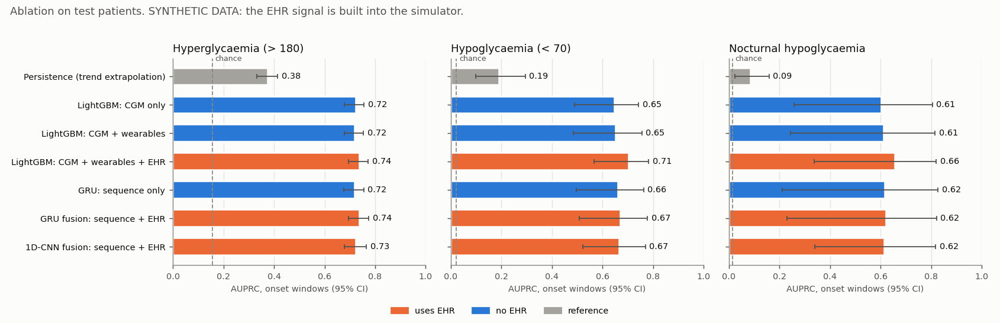
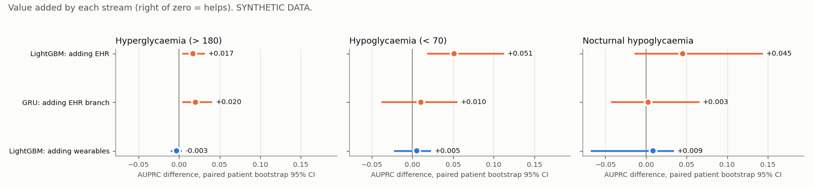
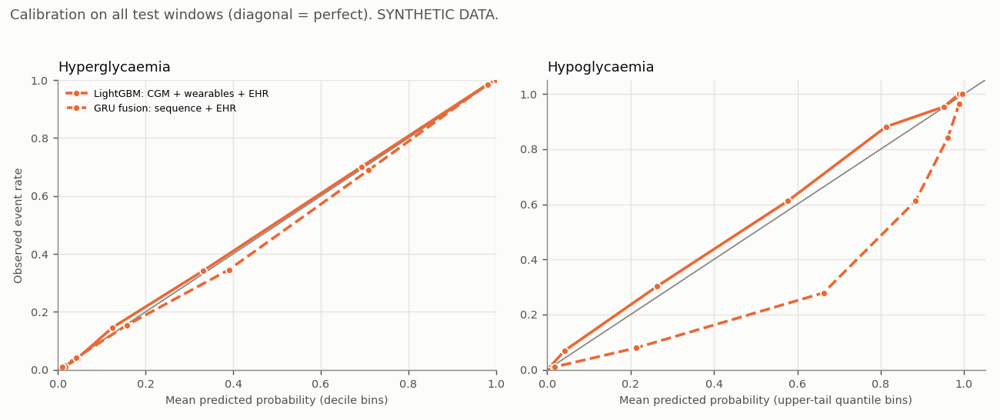
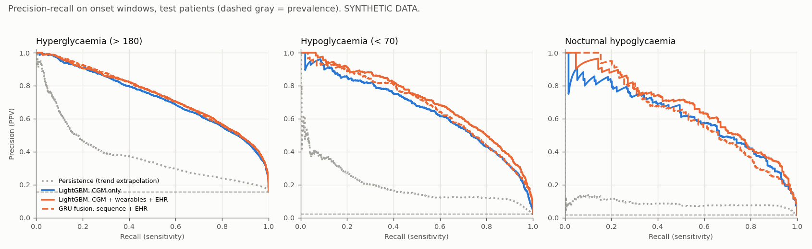

# Ablation results

**SYNTHETIC DATA. Not clinically validated.** The EHR traits drive the simulated glucose dynamics *by design*,
so the EHR gains below show that the pipeline *can* use static context; they do not estimate the value of
EHR data in real patients. Test set: 60 patients, never seen in training or model selection.

*Onset* windows exclude predictions made while the patient is already past the threshold (those are
trivially positive). AUPRC is the headline metric (chance = prevalence); 95% CIs resample whole patients.

## Headline: AUPRC on onset windows

| Model | Uses EHR | Hyper > 180 | Hypo < 70 | Nocturnal hypo | Hypo AUROC | Hypo sens @ 10% FAR |
|---|---|---|---|---|---|---|
| *chance (prevalence)* | | 0.156 | 0.022 | 0.015 | 0.5 | 0.10 |
| Persistence (trend extrapolation) | no | 0.377 (0.331-0.414) | 0.192 (0.099-0.295) | 0.087 (0.024-0.160) | 0.907 | 0.602 |
| LightGBM: CGM only | no | 0.724 (0.679-0.757) | 0.649 (0.489-0.743) | 0.605 (0.259-0.806) | 0.981 | 0.964 |
| LightGBM: CGM + wearables | no | 0.721 (0.678-0.754) | 0.654 (0.484-0.756) | 0.614 (0.244-0.815) | 0.982 | 0.971 |
| LightGBM: CGM + wearables + EHR | yes | 0.739 (0.695-0.772) | 0.705 (0.568-0.782) | 0.659 (0.337-0.820) | 0.987 | 0.980 |
| GRU: sequence only | no | 0.719 (0.677-0.755) | 0.662 (0.496-0.762) | 0.619 (0.210-0.828) | 0.984 | 0.973 |
| GRU fusion: sequence + EHR | yes | 0.740 (0.695-0.775) | 0.672 (0.508-0.778) | 0.622 (0.231-0.822) | 0.985 | 0.980 |
| 1D-CNN fusion: sequence + EHR | yes | 0.726 (0.678-0.765) | 0.667 (0.523-0.769) | 0.617 (0.339-0.818) | 0.985 | 0.979 |

## Does the EHR add value? (paired AUPRC differences)

A minus B on identical patient resamples. *P(A better)* is the share of 200 resamples where A wins.

| Comparison | Target | AUPRC A | AUPRC B | Difference (95% CI) | P(A better) |
|---|---|---|---|---|---|
| LightGBM: adding EHR | Hyperglycaemia (> 180) | 0.739 | 0.721 | +0.017 (+0.004 to +0.032) | 1.00 |
| LightGBM: adding EHR | Hypoglycaemia (< 70) | 0.705 | 0.654 | +0.051 (+0.018 to +0.113) | 1.00 |
| LightGBM: adding EHR | Nocturnal hypoglycaemia | 0.659 | 0.614 | +0.045 (-0.014 to +0.144) | 0.93 |
| GRU: adding EHR branch | Hyperglycaemia (> 180) | 0.740 | 0.719 | +0.020 (+0.004 to +0.041) | 0.99 |
| GRU: adding EHR branch | Hypoglycaemia (< 70) | 0.672 | 0.662 | +0.010 (-0.038 to +0.056) | 0.69 |
| GRU: adding EHR branch | Nocturnal hypoglycaemia | 0.622 | 0.619 | +0.003 (-0.043 to +0.066) | 0.60 |
| LightGBM: adding wearables | Hyperglycaemia (> 180) | 0.721 | 0.724 | -0.003 (-0.010 to +0.004) | 0.23 |
| LightGBM: adding wearables | Hypoglycaemia (< 70) | 0.654 | 0.649 | +0.005 (-0.023 to +0.023) | 0.68 |
| LightGBM: adding wearables | Nocturnal hypoglycaemia | 0.614 | 0.605 | +0.009 (-0.068 to +0.034) | 0.57 |
| LightGBM CGM vs persistence | Hyperglycaemia (> 180) | 0.724 | 0.377 | +0.348 (+0.317 to +0.388) | 1.00 |
| LightGBM CGM vs persistence | Hypoglycaemia (< 70) | 0.649 | 0.192 | +0.457 (+0.358 to +0.525) | 1.00 |
| LightGBM CGM vs persistence | Nocturnal hypoglycaemia | 0.605 | 0.087 | +0.519 (+0.239 to +0.679) | 1.00 |
| GRU fusion vs LightGBM + EHR | Hyperglycaemia (> 180) | 0.740 | 0.739 | +0.001 (-0.013 to +0.016) | 0.54 |
| GRU fusion vs LightGBM + EHR | Hypoglycaemia (< 70) | 0.672 | 0.705 | -0.033 (-0.087 to +0.008) | 0.11 |
| GRU fusion vs LightGBM + EHR | Nocturnal hypoglycaemia | 0.622 | 0.659 | -0.037 (-0.222 to +0.020) | 0.16 |

## Lead time before events

An episode starts at the first reading past the threshold after >= 30 min clear of it. *Detected* = at least
one alert in the 2 h before onset at the given false-alert rate (FAR, set on onset windows). Predictions are
every 30 min, so lead time has 30-min resolution and **is capped at 120 min by the horizon**. At 10% FAR
(about 5 alerting windows per patient-day) detection is lenient and lead times saturate near the cap even
for persistence; the 5% rows are more informative. This is a coarse, optimistic measure.

**Simulator limitation.** In the 2 h before a hypo onset the lowest CGM reading is already 70 mg/dL (median), and before a hyper
onset the highest is 178 mg/dL: simulated lows arrive as slow drifts, so they are easy to see coming. Real lows (exercise, mistimed insulin) can be
much faster; expect real-world detection and lead time to be markedly worse.

| Model | Target | FAR | Episodes | Detected | Median lead (min) | Mean lead (min) |
|---|---|---|---|---|---|---|
| Persistence (trend extrapolation) | hyper | 5% | 1256 | 66% | 25 | 34 |
| LightGBM: CGM only | hyper | 5% | 1256 | 90% | 75 | 70 |
| LightGBM: CGM + wearables | hyper | 5% | 1256 | 90% | 75 | 69 |
| LightGBM: CGM + wearables + EHR | hyper | 5% | 1256 | 91% | 75 | 69 |
| GRU: sequence only | hyper | 5% | 1256 | 91% | 70 | 67 |
| GRU fusion: sequence + EHR | hyper | 5% | 1256 | 91% | 75 | 69 |
| 1D-CNN fusion: sequence + EHR | hyper | 5% | 1256 | 89% | 75 | 69 |
| Persistence (trend extrapolation) | hyper | 10% | 1256 | 80% | 35 | 45 |
| LightGBM: CGM only | hyper | 10% | 1256 | 96% | 95 | 82 |
| LightGBM: CGM + wearables | hyper | 10% | 1256 | 95% | 95 | 82 |
| LightGBM: CGM + wearables + EHR | hyper | 10% | 1256 | 97% | 95 | 82 |
| GRU: sequence only | hyper | 10% | 1256 | 96% | 92 | 79 |
| GRU fusion: sequence + EHR | hyper | 10% | 1256 | 96% | 95 | 83 |
| 1D-CNN fusion: sequence + EHR | hyper | 10% | 1256 | 96% | 95 | 82 |
| Persistence (trend extrapolation) | hypo | 5% | 238 | 75% | 95 | 81 |
| LightGBM: CGM only | hypo | 5% | 238 | 99% | 100 | 94 |
| LightGBM: CGM + wearables | hypo | 5% | 238 | 99% | 100 | 93 |
| LightGBM: CGM + wearables + EHR | hypo | 5% | 238 | 100% | 100 | 95 |
| GRU: sequence only | hypo | 5% | 238 | 98% | 100 | 94 |
| GRU fusion: sequence + EHR | hypo | 5% | 238 | 98% | 100 | 96 |
| 1D-CNN fusion: sequence + EHR | hypo | 5% | 238 | 99% | 100 | 95 |
| Persistence (trend extrapolation) | hypo | 10% | 238 | 88% | 95 | 87 |
| LightGBM: CGM only | hypo | 10% | 238 | 100% | 105 | 97 |
| LightGBM: CGM + wearables | hypo | 10% | 238 | 100% | 105 | 98 |
| LightGBM: CGM + wearables + EHR | hypo | 10% | 238 | 100% | 105 | 98 |
| GRU: sequence only | hypo | 10% | 238 | 100% | 105 | 98 |
| GRU fusion: sequence + EHR | hypo | 10% | 238 | 100% | 105 | 98 |
| 1D-CNN fusion: sequence + EHR | hypo | 10% | 238 | 100% | 105 | 98 |

## Calibration (all test windows)

ECE = count-weighted mean |observed - predicted| over quantile bins (deciles for hyper; upper-tail bins for
the rare hypo target, where deciles collapse to ~0). The fusion model's hypo head is trained
with up-weighted positives (pos_weight = sqrt(neg/pos)), so its raw probabilities overstate hypo risk; they
rank well but should be recalibrated before being shown as absolute probabilities.

| Model | Target | Brier | ECE | Mean predicted | Observed rate |
|---|---|---|---|---|---|
| LightGBM: CGM only | hyper | 0.0617 | 0.0050 | 0.320 | 0.323 |
| LightGBM: CGM only | hypo | 0.0126 | 0.0025 | 0.036 | 0.035 |
| LightGBM: CGM + wearables | hyper | 0.0620 | 0.0046 | 0.321 | 0.323 |
| LightGBM: CGM + wearables | hypo | 0.0125 | 0.0026 | 0.036 | 0.035 |
| LightGBM: CGM + wearables + EHR | hyper | 0.0599 | 0.0064 | 0.320 | 0.323 |
| LightGBM: CGM + wearables + EHR | hypo | 0.0116 | 0.0038 | 0.032 | 0.035 |
| GRU: sequence only | hyper | 0.0626 | 0.0042 | 0.326 | 0.323 |
| GRU: sequence only | hypo | 0.0232 | 0.0352 | 0.070 | 0.035 |
| GRU fusion: sequence + EHR | hyper | 0.0613 | 0.0076 | 0.329 | 0.323 |
| GRU fusion: sequence + EHR | hypo | 0.0176 | 0.0192 | 0.054 | 0.035 |
| 1D-CNN fusion: sequence + EHR | hyper | 0.0616 | 0.0062 | 0.324 | 0.323 |
| 1D-CNN fusion: sequence + EHR | hypo | 0.0164 | 0.0178 | 0.053 | 0.035 |

Full per-subset metrics (incl. *all-window* and sensitivity / PPV / alert burden at 5% and 10% FAR):
[ablation_results.csv](ablation_results.csv).
