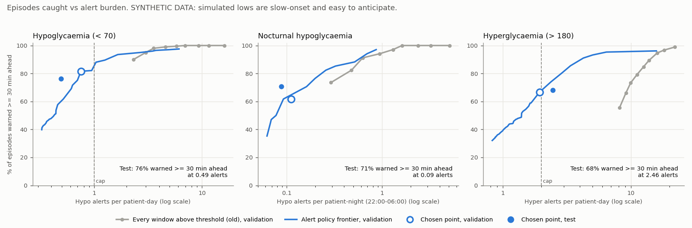

# Alert policy: one alert per risk episode

**SYNTHETIC DATA. Not clinically validated.** The numbers describe how the alert logic behaves on simulated
patients whose lows are slow and easy to see coming. They are not an estimate of real-world performance.

## Headline (60 test patients)

* **Hypoglycaemia:** the policy warns of **76% of hypo episodes at least 30 minutes before onset**
  (83% with >= 15 min) with **0.49 hypo alerts per patient-day**, of which
  0.17 are false (PPV 66% per alert; median lead 65 min).
  Nocturnal lows: 71% warned >= 30 min ahead, 0.09 hypo alerts per night.
* **Hyperglycaemia:** 68% of hyper episodes warned >= 30 min ahead with 2.46 alerts
  per patient-day (PPV 69%).
* **Before** (every 30-minute window at or above the 5%-false-alert-rate threshold counted as an alert):
  3.0 hypo and 15.9 hyper alerting windows per patient-day, with the
  same alarm repeating every 30 min while risk stays high.
* **The price:** for 6x fewer hypo alerts the policy gives up 21 points of
  episodes caught >= 30 min ahead (98% -> 76%) and median lead time falls from 105 to 65 min.
  Where to sit on that curve is a clinical choice (figure below).
* On test the hyper policy raises 2.46 alerts per patient-day, above the 2 cap it met on validation (1.94).

## Method

**Policy** (`src/twin/alerts.py`, one per target). An alert fires when the predicted 2-hour risk reaches the
threshold. After that, the policy stays quiet until the **refractory period** has passed. Optional parts:
* **Hysteresis:** re-arm only after risk has fallen below a lower level.
* **Escalation:** with hysteresis, alert again if risk rises to k x its level at the last alert.
* **Daily budget:** at most N alerts per patient per calendar day.

No predictive alert is raised while the CGM already reads past the threshold: the CGM's own threshold alarm
covers that case. All parts are implemented and tested; validation decides which to use.

**Episodes.** Consensus-style CGM episodes: >= 15 min (3 readings) past the threshold, ended by >= 15 min
clear of it. Nocturnal = onset 22:00-06:00. An episode is *eligible* if any prediction was made in the 2 h
before onset (episodes inside data gaps cannot be warned of and are excluded).

**Metrics.**
* *Caught with >= L min warning:* an alert fired between 2 h and L min before onset (the alert's 2-hour
  horizon contains the onset).
* *Lead time:* onset minus the earliest such alert. Predictions run every 30 min, so lead time is capped
  at 120 min.
* *PPV per alert:* share of alerts followed by any reading past the threshold within 2 h (the model's label).
* *False alerts per patient-day:* the remaining alerts, per 24 h of monitored time (30 min per prediction).

**Choosing the operating point on validation patients only.** Every combination below was run on the
46 validation patients:
* threshold: false-alert rate on validation onset windows of 0.01, 0.02, 0.03, 0.05, 0.075, 0.1, 0.15, 0.2, 0.3;
* re-arm level: none, or 1.0 / 0.5 / 0.25 x threshold;
* refractory period: 0, 1, 1.5, 2, 3, 4 h;
* daily budget: none, 4 or 2; escalation (with hysteresis only): none, 2x or 3x.

The rule was fixed in advance: maximise episodes caught with >= 30 min warning, subject to at most
1 hypo or 2 hyper alerts per patient-day. Within
1 point of the best, take the fewest alerts, then the simplest policy. The chosen points are in
`config.yaml` (`twin.alert_policy`), which the dashboard uses. Test patients played no part.

| Target | Threshold (val FAR) | Refractory | Re-arm below | Escalation | Daily budget | Val: caught >= 30 min | Val: alerts / day |
|---|---|---|---|---|---|---|---|
| Hypoglycaemia (< 70) | 36.8% (1%) | 1.5 h | none | none | none | 82% | 0.75 |
| Hyperglycaemia (> 180) | 48.0% (3%) | 1.5 h | none | none | none | 67% | 1.94 |

### What each part does (validation patients, chosen threshold)

The refractory period does most of the work: for hypo it cuts alerts from 2.32 to 0.75
per patient-day while episodes caught >= 30 min fall from 90% to 82%.
**Hysteresis hurts here** (hypo caught >= 30 min: 43%). Simulated lows are slow
drifts: risk crosses the threshold, often more than 2 h before onset, and then stays high. A policy that
waits for risk to fall before re-arming stays silent exactly when the low arrives. A refractory period
without hysteresis acts as a reminder at most every 1.5 h while risk stays high, which is what catches
these lows. Escalation recovers only part of the loss. The daily budget only removes alerts once the
cap is tight enough to drop real warnings.

| Target | Policy | Caught >= 15 min | Caught >= 30 min | Alerts / patient-day | False alerts / patient-day | PPV |
|---|---|---|---|---|---|---|
| hypo | Every window above threshold (old) | 94% | 90% | 2.32 | 0.50 | 78% |
| hypo | No alert while CGM already past threshold | 92% | 85% | 1.46 | 0.46 | 69% |
| hypo | + refractory 1.5 h (reminder while risk stays high) | 89% | 82% | 0.75 | 0.27 | 64% |
| hypo | + hysteresis: re-arm below 0.5 x threshold | 48% | 43% | 0.35 | 0.14 | 62% |
| hypo | + hysteresis + escalation at 2x | 51% | 47% | 0.38 | 0.14 | 63% |
| hypo | **Chosen policy** | 89% | 82% | 0.75 | 0.27 | 64% |
| hyper | Every window above threshold (old) | 81% | 73% | 9.95 | 1.28 | 87% |
| hyper | No alert while CGM already past threshold | 77% | 68% | 3.79 | 1.11 | 71% |
| hyper | + refractory 1.5 h (reminder while risk stays high) | 76% | 67% | 1.94 | 0.66 | 66% |
| hyper | + hysteresis: re-arm below 0.5 x threshold | 50% | 43% | 1.25 | 0.50 | 60% |
| hyper | + hysteresis + escalation at 2x | 50% | 43% | 1.25 | 0.50 | 60% |
| hyper | **Chosen policy** | 76% | 67% | 1.94 | 0.66 | 66% |

PPV of window-level alerting looks high partly because it includes windows where the CGM is already
past the threshold, which are trivially positive.

## Test results (60 patients, 95% patient-bootstrap CIs)

*Old* = every 30-min window at or above the 5%-FAR threshold counts as an alert (previous dashboard).
*Same threshold, every window* isolates the policy from the threshold change. *Policy* = chosen above.

| Target | Alerting | Episodes | Caught (any warning) | Caught >= 15 min | Caught >= 30 min | Median lead (min) | Alerts / patient-day | False alerts / patient-day | PPV per alert |
|---|---|---|---|---|---|---|---|---|---|
| Hypoglycaemia (< 70) | Old: every window, 5% FAR | 173 | 99% (98%-100%) | 99% (97%-100%) | 98% (94%-100%) | 105 | 3.03 (1.57-5.06) | 1.47 (0.83-2.32) | 51% (40%-59%) |
| Hypoglycaemia (< 70) | Same threshold (1% FAR), every window | 173 | 96% (93%-98%) | 92% (89%-96%) | 90% (86%-93%) | 100 | 1.63 (0.75-2.92) | 0.35 (0.17-0.57) | 79% (69%-84%) |
| Hypoglycaemia (< 70) | **Policy (chosen on validation)** | 173 | 90% (83%-93%) | 83% (76%-86%) | 76% (68%-82%) | 65 | 0.49 (0.23-0.86) | 0.17 (0.08-0.28) | 66% (56%-73%) |
| Hyperglycaemia (> 180) | Old: every window, 5% FAR | 1199 | 96% (94%-97%) | 91% (88%-93%) | 83% (78%-87%) | 95 | 15.93 (12.50-18.89) | 2.36 (1.92-2.84) | 85% (82%-88%) |
| Hyperglycaemia (> 180) | Same threshold (3% FAR), every window | 1199 | 92% (90%-95%) | 85% (81%-89%) | 75% (68%-81%) | 85 | 14.50 (11.19-17.37) | 1.56 (1.25-1.84) | 89% (87%-91%) |
| Hyperglycaemia (> 180) | **Policy (chosen on validation)** | 1199 | 89% (86%-91%) | 81% (77%-84%) | 68% (62%-73%) | 60 | 2.46 (2.02-2.84) | 0.76 (0.62-0.92) | 69% (65%-72%) |

**Nocturnal hypoglycaemia (test).** Onset 22:00-06:00; alerts counted per 8-hour night.

| Alerting | Nocturnal episodes | Caught >= 15 min | Caught >= 30 min | Hypo alerts per night |
|---|---|---|---|---|
| Old: every window, 5% FAR | 34 | 97% (95%-100%) | 97% (95%-100%) | 0.58 (0.12-1.18) |
| Same threshold (1% FAR), every window | 34 | 79% (71%-86%) | 79% (71%-86%) | 0.29 (0.03-0.69) |
| **Policy (chosen on validation)** | 34 | 76% (71%-86%) | 71% (67%-75%) | 0.09 (0.01-0.19) |

*Sensitivity to the episode definition.* Counting any single reading < 70 as an onset (after >= 30 min
clear; the definition in the ablation lead-time table) gives 238 hypo episodes. The policy
catches 72% of them with >= 30 min warning (82% with >= 15 min).

## Trade-off: episodes caught vs alert burden

Lines are computed on validation patients. Grey: the old window-level alerting at each threshold. Blue:
for each alert rate, the best policy in the grid. Hollow dot = chosen point on validation; filled dot = the
same policy on test. Log x-axis.

## Caveats

* **Simulated lows are slow-onset.** In the 2 h before a simulated hypo onset, glucose is typically already
  drifting toward 70 mg/dL (median lowest reading 70 mg/dL, see [ablation_results.md](ablation_results.md)),
  so warnings 30+ min ahead are easy here. Real lows after exercise or mistimed insulin can fall much
  faster; expect fewer episodes caught and shorter lead times on real data. The same slow drifts are
  why hysteresis failed; on real data with faster dynamics it may be worth re-testing.
* **No human in the loop.** Alerts are scored as if nobody acted on them; in practice a treated alert
  prevents the episode and would then look like a false alert.
* **Coarse lead time.** Predictions run every 30 min with a 2-hour horizon. Lead times are capped at
  120 min, and an alert more than 2 h before onset does not count as a warning.
* **PPV depends on prevalence.** Hypo episodes are rare, so the false alerts per day are the number a
  patient actually lives with.
* **Small cohorts.** 46 validation and 60 test patients; the CIs resample
  whole patients and are wide for nocturnal hypo.
* **The alert cap is a clinical judgement**, not a fitted quantity; a different cap gives a different
  point on the trade-off curve. Full validation sweep: [alert_policy_sweep_val.csv](alert_policy_sweep_val.csv).
  Test rows: [alert_policy_test.csv](alert_policy_test.csv).
