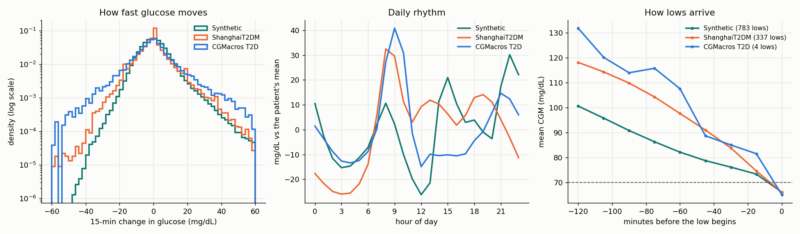

# How realistic is the simulator?

**Synthetic vs real CGM, metric by metric.** Generated by `python -m src.eval.simulator_realism`. Real data:
ShanghaiT2DM (CC BY 4.0) and CGMacros T2D (CC BY-NC-SA 4.0), never redistributed; this page holds aggregates only.

All series are compared on a common 15-minute grid (ShanghaiT2DM's native interval). Values are the median
and interquartile range across patients (ShanghaiT2DM: recording periods). The verdict compares the
synthetic median with the interquartile range of the two real cohorts pooled. The real cohorts are not the
target population (a partly hospitalised Chinese cohort and 14 US adults), so they bound realism rather
than define it.

| Metric | Synthetic (n=300) | ShanghaiT2DM (n=109) | CGMacros T2D (n=14) | Synthetic vs real |
|---|---|---|---|---|
| Mean glucose (mg/dL) | 138 (120 to 155) | 140 (119 to 158) | 156 (144 to 190) | within real range |
| Coefficient of variation (%) | 22.4 (18.6 to 29.0) | 27.4 (23.8 to 32.9) | 22.3 (20.0 to 29.0) | **too low** |
| Time in range 70-180 (%) | 88.2 (73.7 to 95.6) | 83.5 (66.9 to 90.8) | 80.5 (52.1 to 86.6) | within real range |
| Time above 180 (%) | 9.8 (3.3 to 23.8) | 14.6 (5.8 to 31.1) | 18.9 (13.1 to 47.8) | within real range |
| Time below 70 (%), cohort mean | 1.48 | 2.36 | 0.15 | within real range |
| Hypo episodes per day, cohort mean | 0.20 | 0.30 | 0.04 | within real range |
| Patients with any low episode (%) | 25 | 58 | 21 | within real range |
| Hyper episodes per day | 1.17 (0.44 to 1.93) | 1.58 (1.01 to 2.00) | 2.24 (1.85 to 2.89) | within real range |
| SD of 15-min change (mg/dL) | 7.9 (7.0 to 9.0) | 9.5 (7.7 to 10.9) | 13.5 (11.9 to 15.0) | within real range |
| Large swings: 95th percentile of the absolute 15-min change (mg/dL) | 16.0 (14.0 to 18.1) | 19.8 (16.2 to 23.4) | 28.0 (26.4 to 33.0) | **too low** |
| Direction reversals (% of steps) | 41.5 (38.2 to 44.0) | 22.5 (19.5 to 24.3) | 36.6 (35.7 to 39.0) | **too high** |
| Glucose 60 min before a low (mg/dL) | 82 (79 to 87) | 94 (85 to 105) | 113 (91 to 124) | **too low** |
| Fall rate in the hour before a low (mg/dL/min) | -0.26 (-0.35 to -0.20) | -0.47 (-0.64 to -0.32) | -0.77 (-0.94 to -0.48) | **too slow** |
| Daily rhythm: correlation of the hourly profile with the real cohorts' (the two real cohorts with each other: 0.55) | 0.28 |  |  | **different** |

## What this means

* **Lows arrive too slowly, which is why synthetic lows were so easy to predict.** An hour before a low,
  synthetic glucose is already at 82 mg/dL and falls 0.26 mg/dL per
  minute; real patients are at 94 and 113 mg/dL and fall 0.47 and 0.77
  mg/dL per minute. This explains the drop in alert performance on real patients (76% to 35% of lows warned
  30 minutes ahead, [real_model.md](real_model.md)).
* **Not too smooth, but jittery on top of slow.** We had written that simulated glucose is smoother than real.
  At the 15-minute scale it reverses direction more often than real CGM (42% of steps
  vs 22.5 and 36.6%): the sensor-noise model adds short wiggles, while large swings are rarer
  (16 vs 19.8 and 28.0 mg/dL) and overall variability is lower (CV 22%).
* **Level, time in range and event rates are realistic.** Mean glucose, time in and above range, and the
  rates of highs and lows all fall within the real cohorts' range.
* **The daily rhythm differs.** Both real cohorts peak after breakfast (08:00-09:00); the simulator's largest rise
  comes late in the evening. The hourly profile correlates weakly with the real cohorts' (they also differ
  from each other). The simulator's meal and dosing times are a likely cause, not tested here.
* **Lows without glucose-lowering drugs never happen in the simulator but do in real data** (ShanghaiT2DM:
  patients on neither insulin nor a sulfonylurea have lows too; some may be sensor artefacts or other drugs).
  Insulin users have fewer lows than sulfonylurea users in both the simulator and ShanghaiT2DM.

**Next simulator changes this points to:** faster, steeper falls into lows; less short-term sensor jitter and
more large physiological swings (meal size and timing variability); irregular daily schedules; and a small
rate of lows in patients without insulin or sulfonylureas. Each can now be checked against this table.

## Lows by drug class

Mean per patient. CGMacros has no medication records.

| Cohort | Group | Patients | Hypo episodes per day | Time below 70 (%) |
|---|---|---|---|---|
| ShanghaiT2DM | insulin | 56 | 0.19 | 1.13 |
| ShanghaiT2DM | neither | 42 | 0.39 | 3.71 |
| ShanghaiT2DM | sulfonylurea, no insulin | 11 | 0.52 | 3.45 |
| Synthetic | insulin | 37 | 0.14 | 0.84 |
| Synthetic | neither | 173 | 0.00 | 0.00 |
| Synthetic | sulfonylurea, no insulin | 90 | 0.60 | 4.58 |
