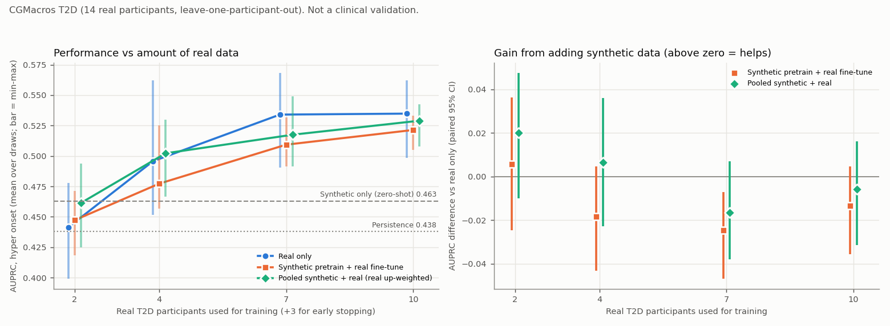

# Does synthetic data help when real data is scarce? (CGMacros T2D)

**A small experiment on 14 real participants, not a clinical validation.** The
[external check](external_validation.md) found that our synthetic-trained model transfers only weakly to
real CGM. A model trained on the real cohort did clearly better. This page asks the follow-up question:
when only a few real participants are available, does the synthetic data still earn its place, either
as pretraining or mixed into the training set?

**Short answer: no, not reliably.** With 2 real participants, mixing in synthetic data gives a small gain that is
significant on AUROC only. From 4 participants up it adds nothing, and from 7 up it costs a little. Its one
consistent benefit is lower variance between random draws of training participants.

Numbers: [transfer_experiment.csv](transfer_experiment.csv) (full-data metrics),
[transfer_experiment_paired.csv](transfer_experiment_paired.csv) (paired differences),
[transfer_learning_curve.csv](transfer_learning_curve.csv) (every learning-curve draw) and
[transfer_learning_curve_paired.csv](transfer_learning_curve_paired.csv). All files hold aggregate metrics only.

## Setup

Everything except the training data is the same as in the external check
([`external_cgmacros.py`](../src/eval/external_cgmacros.py)): 14 CGMacros T2D participants, Dexcom G6, 6 h
history, 2 h horizon, 30-min stride, hyper = any CGM > 180 mg/dL in the horizon, 24 CGM + time-of-day
features, the same LightGBM hyperparameters, and metrics on **onset** windows (1,207 positive of 4,377,
prevalence 0.276). Hypoglycaemia is not studied: the cohort has 31 hypo windows from 3 participants.

**Models** ([`src/eval/transfer_cgmacros.py`](../src/eval/transfer_cgmacros.py)):

| Model | Synthetic data | Real data |
|---|---|---|
| Persistence | | none (trend extrapolation) |
| Synthetic only, zero-shot | 125,415 synthetic train windows | none |
| **Real only** (the existing LOPO baseline) | | training participants |
| **Pretrain + fine-tune** | the zero-shot model is the starting point | extra boosting rounds on the training participants |
| **Pooled, real up-weighted** | synthetic train windows, weight 1 | training windows, weighted so both sources carry equal total weight |
| Pooled, unweighted | synthetic train windows | training windows, weight 1 (full-data comparison only) |

* **Fine-tuning** is LightGBM continued training. New trees boost from the synthetic model's log-odds
  on each real window, as `lgb.train(init_model=...)` does.
* **The synthetic model** is retrained from the cached synthetic features with the pipeline's seed. Its
  predictions match `lgbm_cgm_hyper.txt` exactly (max abs difference 0), and it reproduces the zero-shot
  row of the external check.
* **Early stopping:** every model that trains on real data early-stops on the same 3 held-out real
  participants, scored by validation AUPRC.
* **No tuning for this experiment.** Every setting was fixed in advance: the learning rate, the
  balanced-weight rule and the number of rounds. Tuning any of them on 14 participants would mostly fit noise.

**Protocol: leave one participant out (LOPO).** Each participant is scored by models that never saw
them. Out-of-fold scores are pooled over all 14 participants.
* **Full data:** 10 training participants and 3 early-stopping participants, using exactly the split of
  the external check. The real-only row reproduces its AUPRC of 0.537.
* **Learning curve:** for each held-out participant, 3 of the other 13 are drawn at random for early
  stopping. Then k ∈ {2, 4, 7, 10} training participants are drawn from the remaining 10.
  * The sets are nested: the k = 2 set is inside the k = 4 set, and so on.
  * There are 10 random draws per held-out participant.
  * All methods see exactly the same participants in every draw, so the comparisons are paired.
* **Uncertainty:** paired patient-bootstrap differences with 200 resamples (`paired_bootstrap_diff`).
  * In the learning curve, the statistic in each resample is the AUPRC or AUROC difference averaged
    over the 10 draws.
  * The bootstrap resamples evaluation participants; the 10 draws handle the choice of training participants.

## Results: full data (10 training participants)

Onset windows, 14 participants, prevalence 0.276.

| Model | AUPRC (95 % CI) | AUROC (95 % CI) | Sens @ 10 % FAR | Mean predicted | ECE |
|---|---|---|---|---|---|
| Persistence | 0.438 (0.370-0.522) | 0.659 (0.618-0.691) | 0.240 | | |
| Synthetic only, zero-shot | 0.463 (0.388-0.547) | 0.698 (0.656-0.736) | 0.266 | 0.225 | 0.136 |
| **Real only** | 0.537 (0.474-0.614) | **0.771** (0.732-0.808) | **0.397** | 0.291 | 0.023 |
| Pretrain + fine-tune | 0.527 (0.465-0.603) | 0.761 (0.729-0.788) | 0.370 | 0.274 | 0.085 |
| Pooled, real up-weighted | **0.550** (0.471-0.622) | 0.763 (0.730-0.792) | 0.389 | 0.261 | **0.022** |
| Pooled, unweighted | 0.485 (0.404-0.565) | 0.710 (0.681-0.736) | 0.297 | 0.238 | 0.098 |

Paired differences against real only (A - B, onset windows):

| Comparison | AUPRC | AUROC |
|---|---|---|
| Fine-tune vs real only | -0.011 (-0.037 to +0.010) | -0.010 (-0.026 to +0.006) |
| Pooled (up-weighted) vs real only | +0.013 (-0.022 to +0.030) | -0.008 (-0.026 to +0.008) |
| Pooled (unweighted) vs real only | **-0.053** (-0.096 to -0.011) | **-0.061** (-0.085 to -0.040) |

Bold = 95 % CI excludes zero. Every model trained on real data beats zero-shot by +0.06 to +0.09 AUPRC
(all CIs exclude zero), except unweighted pooling.

## Results: learning curve



AUPRC on onset windows, mean over 10 draws (min-max across draws in brackets):

| Real training participants | Real only | Pretrain + fine-tune | Pooled, real up-weighted |
|---|---|---|---|
| 2 | 0.441 (0.399-0.478) | 0.447 (0.418-0.471) | 0.461 (0.425-0.494) |
| 4 | 0.496 (0.452-0.562) | 0.477 (0.457-0.525) | 0.502 (0.467-0.530) |
| 7 | 0.534 (0.491-0.568) | 0.509 (0.491-0.532) | 0.517 (0.491-0.549) |
| 10 | 0.535 (0.498-0.562) | 0.521 (0.505-0.533) | 0.529 (0.508-0.543) |
| *0 (zero-shot)* | *0.463* | | |

Paired difference against real only, averaged over the draws (95 % CI):

| k | Fine-tune: AUPRC | Fine-tune: AUROC | Pooled: AUPRC | Pooled: AUROC |
|---|---|---|---|---|
| 2 | +0.006 (-0.025 to +0.036) | +0.013 (-0.022 to +0.038) | +0.020 (-0.010 to +0.048) | **+0.029** (+0.006 to +0.044) |
| 4 | -0.018 (-0.043 to +0.005) | -0.014 (-0.036 to +0.005) | +0.007 (-0.023 to +0.036) | +0.004 (-0.020 to +0.025) |
| 7 | **-0.025** (-0.047 to -0.007) | **-0.022** (-0.032 to -0.013) | -0.017 (-0.038 to +0.007) | **-0.018** (-0.036 to -0.001) |
| 10 | -0.013 (-0.035 to +0.005) | -0.012 (-0.031 to +0.003) | -0.006 (-0.031 to +0.016) | -0.009 (-0.032 to +0.011) |

**When does real data overtake the synthetic model?** Real only vs zero-shot, AUPRC:
* k = 2: -0.022 (-0.057 to +0.019)
* k = 4: +0.033 (-0.006 to +0.074)
* k = 7: **+0.071** (+0.039 to +0.104)
* k = 10: **+0.072** (+0.034 to +0.113)

The pooled model already beats zero-shot at k = 4: **+0.039** (+0.012 to +0.064).

Spread across draws (SD of AUPRC), real only vs fine-tune vs pooled: 0.030 / 0.016 / 0.022 at k = 2,
0.017 / 0.009 / 0.010 at k = 10.

## Reading this honestly

* **Synthetic data does not reliably improve the real-data model.**
  * The only gain is at k = 2, for pooling: +0.029 AUROC, with a CI that just excludes zero. The AUPRC gain
    (+0.020) is not significant.
  * From k = 4 up, both ways of using synthetic data are level with real only or slightly worse.
    Fine-tuning is significantly worse at k = 7.
  * With 16 paired comparisons in the curve, one marginal win and a few marginal losses are best read as
    "no benefit", not as findings one by one.
* **With 2 real participants, nothing beats the synthetic model on its own.** Real-only and augmented
  models alike score at or below zero-shot (0.463). Real data overtakes it between 4 and 7 participants
  (that is 7-10 participants touched, counting the 3 used for early stopping).
* **What synthetic data does buy is stability.** It cuts the spread across random draws of
  training participants by a third to a half. It acts as a regulariser that pulls the model toward the simulator's
  glucose-to-outcome mapping. That mapping is biased for real CGM, so the pull trades variance for
  bias. On this cohort the trade stops paying off by about 4 participants.
* **Fine-tuning inherits the synthetic model's miscalibration.** Its ECE is 0.085, against 0.023 for
  real only, because the trees boost from probabilities that underpredict risk. The balanced pooled
  model is as well calibrated as real only (0.022).
* **Weighting decides whether pooling is harmless or harmful.** Unweighted, the real windows are about 3.5 %
  of the training set and get drowned out: -0.053 AUPRC against real only, which is significant.
* **The choice of early-stopping participants matters as much as the method.** At k = 10 the draws differ
  only in which 3 participants are used for early stopping. Even so, real-only AUPRC ranges from 0.498 to
  0.562, wider than any gap between methods.
* **Implication for this project:**
  * The synthetic model is a sensible starting point only when no real data exists at all.
  * A handful of real participants is worth more than any amount of the current synthetic data.
  * A more realistic simulator, especially meal responses and daily rhythm, is likely to pay off more than a
    cleverer way of mixing the two sources.

## Caveats

* **Tiny cohort.** There are 14 participants with about 10 days each. The effective sample is close to
  14, so differences of a few AUPRC points cannot be resolved.
* **One fixed recipe per method.** Other variants could change the picture but were not tried: a lower
  fine-tuning learning rate, other real-window weights, or importance weighting of synthetic windows by
  similarity to real ones. Trying many of them on 14 participants would mostly fit noise.
* **Only hyperglycaemia onset.** The synthetic data's main purpose, medication-driven hypoglycaemia,
  cannot be tested on this cohort.
* **Different population and sensor** from the simulator's target (US vs Indian T2D, no medication
  data). See [external_validation.md](external_validation.md).
* **The learning-curve CIs leave out some uncertainty.** They resample evaluation participants and average over 10 training draws.
  They do not cover the fact that all draws come from the same 14 people.
* **Not a clinical validation** of any kind.

## Reproduce

Needs the CGMacros CSVs (see [external_validation.md](external_validation.md#reproduce)) and the cached
synthetic features (`window_features.npz` + `windows.csv.gz` from the pipeline; the copies in
`demo_bundle/processed/` are identical):

```bash
python -m src.eval.transfer_cgmacros --data-dir data/external/cgmacros --synthetic-dir demo_bundle/processed --draws 10
```

It takes about 20 minutes on an 8-core laptop: 56 full-data fits plus 1,680 learning-curve fits, where
the pooled fits dominate. It writes the four CSVs above and `docs/figures/fig_transfer_learning_curve.png`.
